# SitePower

**Week-by-week temporary electrical demand for a construction site, with an honest uncertainty band.**

> **Planning estimate only.** Results depend on the equipment figures, load factors and diversity assumptions entered. This is not a supply design or a quotation. Confirm with the supplier and a competent person.

<p align="center">
  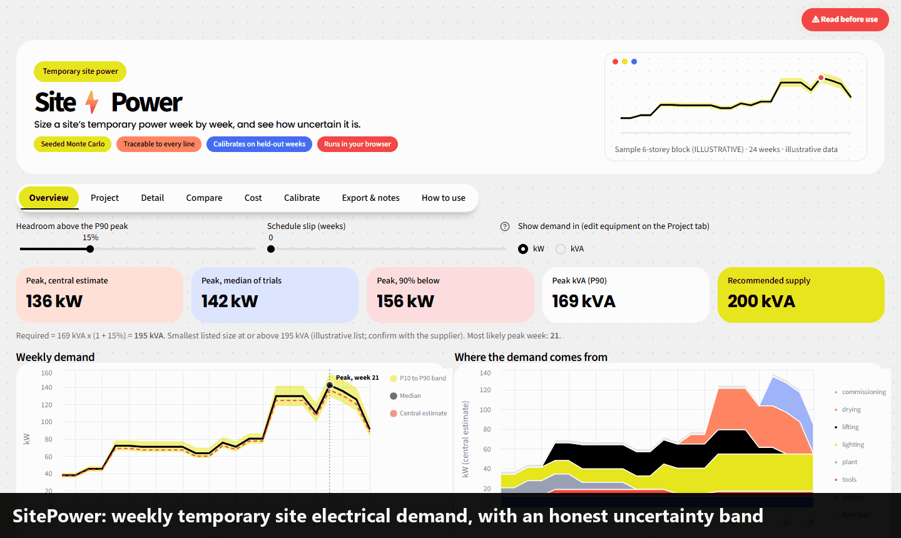
</p>

- **Live demo:** https://habibullahmanzoor.github.io/sitepower/ . A static page that runs the whole app **inside your browser**: there is no server, and nothing you enter leaves your device (see [Hosting](#hosting-github-pages-no-server)). The first visit downloads about 40 MB, so give it 10 to 25 seconds.
- **Status:** weekend project. about 110 tests, 95% library coverage, `ruff` and `mypy --strict` clean.

## The problem

Temporary supplies on construction sites are often sized by rule of thumb or copied from the last job. Too small and the site stops. Too large and the project pays for capacity and a connection it never uses. SitePower builds the estimate bottom-up from the equipment hire schedule and shows how uncertain it is.

## What it does

The page has seven tabs: **Project** (what is on site and when), **Estimate** (with schedule slip, peak drivers and phases), **Compare** (two schedules side by side), **Cost** (generator or grid), **Calibrate**, **Export & notes** (CSV, JSON and a printable HTML report) and **How to use**.

1. **Estimate.** Enter which equipment is on site in which weeks. It computes demand in kW and kVA for every week.
2. **Uncertainty.** A seeded Monte Carlo draws each equipment type's load factor from a triangular distribution and reports P10, P50 and P90 per week, plus the peak and the week it most likely falls in.
3. **Sizing.** Peak kVA at the 90th percentile, plus your headroom, mapped to the smallest size on a configurable list.
4. **Traceability.** Pick any week and see exactly which equipment lines, quantities and diversity factors produced it.
5. **Calibration (optional).** Upload metered half-hourly readings. It proposes a load-factor scale, judged **only on weeks it was not fitted on**, and will not let you apply it if it did not help.
6. **Schedule slip.** Optionally let every hire start up to N weeks late in each trial; the band then covers schedule risk too.
7. **Compare, cost, phases, drivers.** Two schedules side by side, a generator-versus-grid cost model (your prices), per-phase peaks, and which equipment drives a week.
8. **Export.** Weekly profile as CSV, project as JSON, a printable HTML report.

## Screenshots

<p align="center">
  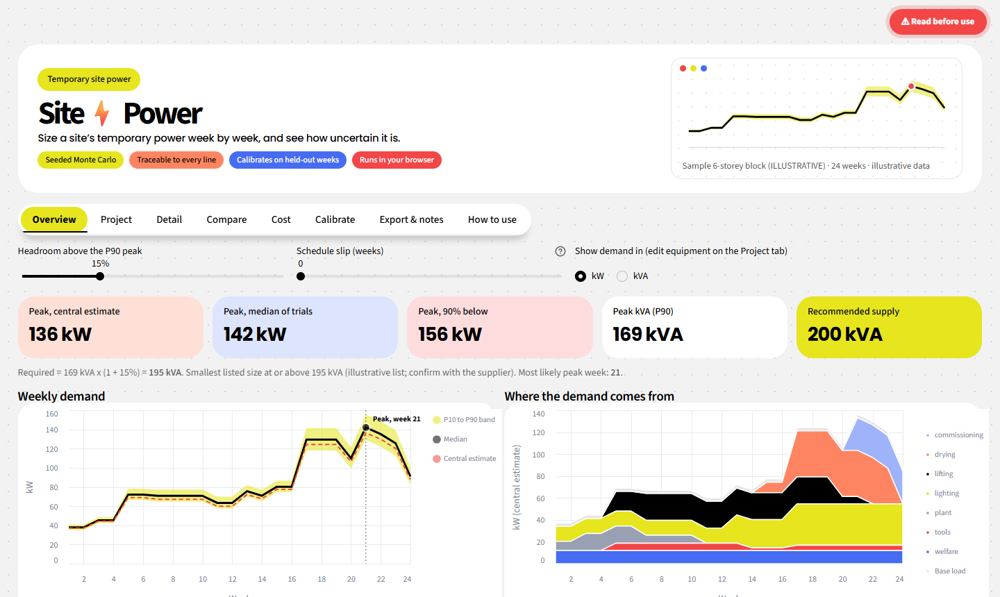
</p>

<table>
  <tr>
    <td width="50%">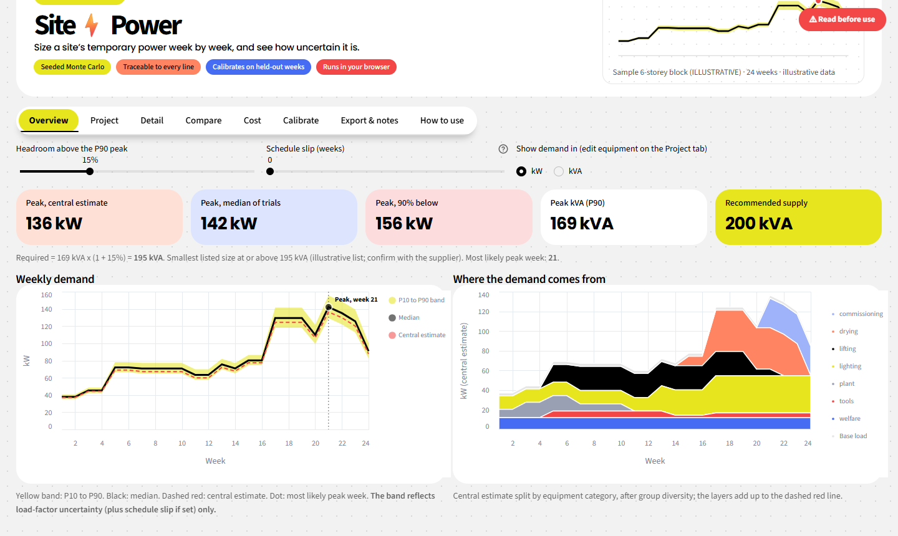<br><sub><b>Overview.</b> Weekly demand with its uncertainty band, next to where the demand comes from. Both charts have legends.</sub></td>
    <td width="50%">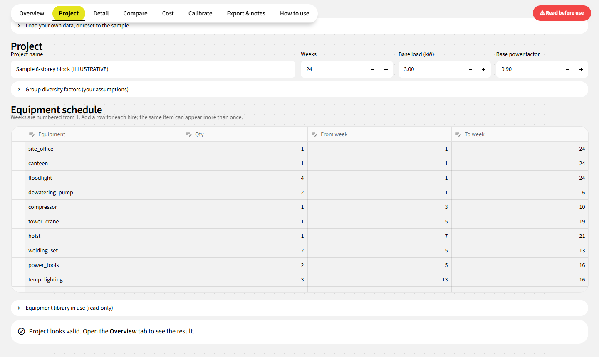<br><sub><b>Project.</b> Editable hire schedule with row-level validation.</sub></td>
  </tr>
  <tr>
    <td width="50%">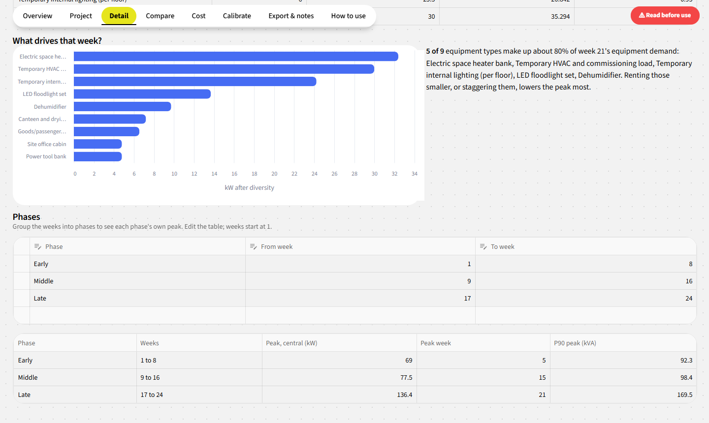<br><sub><b>Detail.</b> Which equipment drives a week, and the peak of each phase.</sub></td>
    <td width="50%">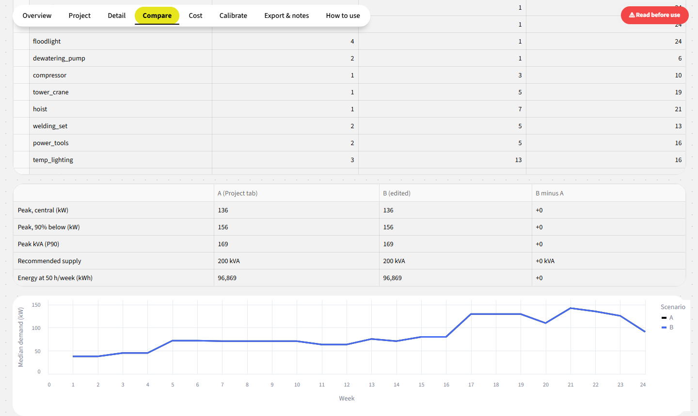<br><sub><b>Compare.</b> Edit a copy of the schedule and see the difference in peak, supply size and energy.</sub></td>
  </tr>
  <tr>
    <td width="50%">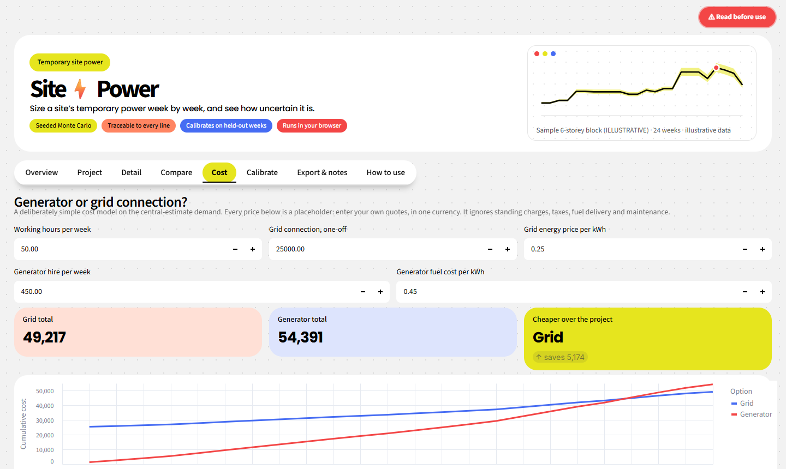<br><sub><b>Cost.</b> Generator against grid connection, using your own prices.</sub></td>
    <td width="50%">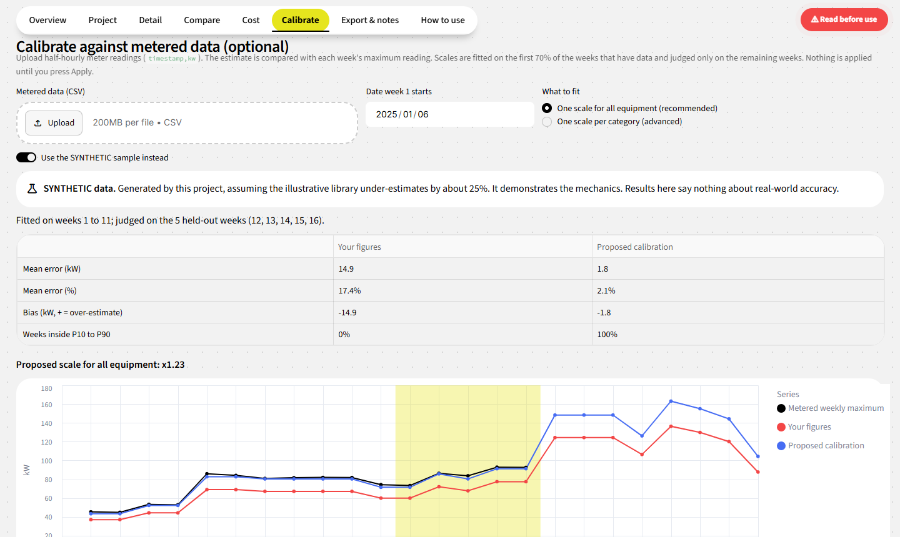<br><sub><b>Calibrate.</b> Errors are measured on held-out weeks. The sample data is labelled SYNTHETIC.</sub></td>
  </tr>
  <tr>
    <td width="50%">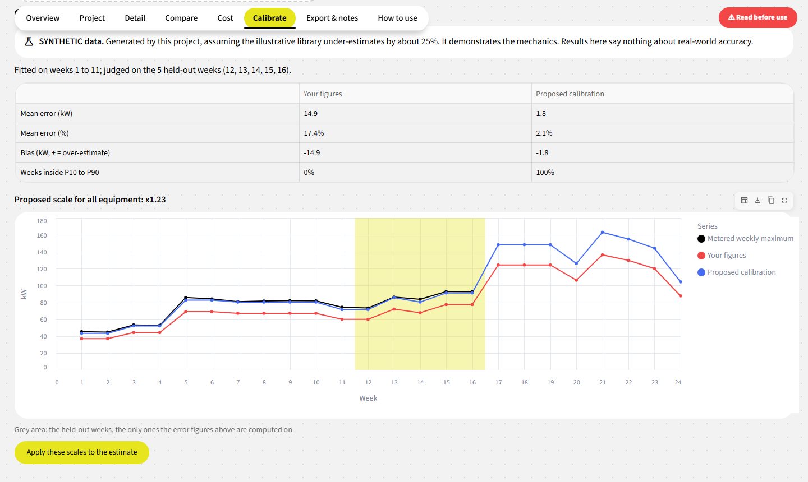<br><sub><b>Calibration chart.</b> Metered readings, your figures and the proposal; the shaded weeks are held out.</sub></td>
    <td width="50%">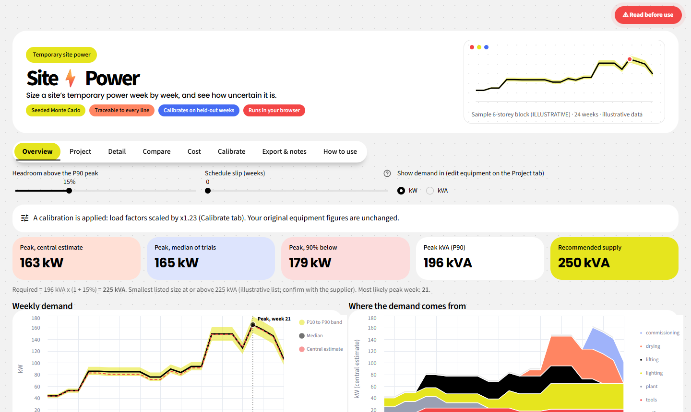<br><sub><b>After applying.</b> A banner says a calibration is active; your own figures are never overwritten.</sub></td>
  </tr>
  <tr>
    <td width="50%">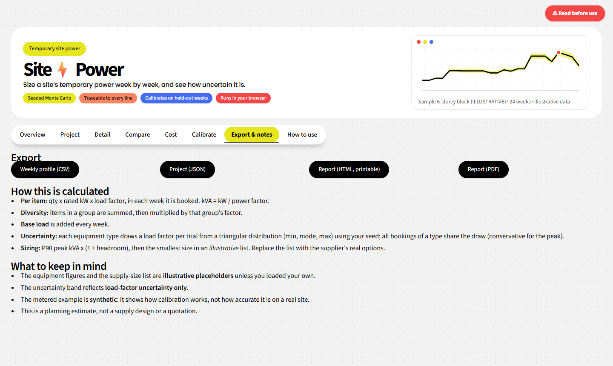<br><sub><b>Export.</b> CSV, JSON, and a report as PDF or printable HTML.</sub></td>
    <td width="50%">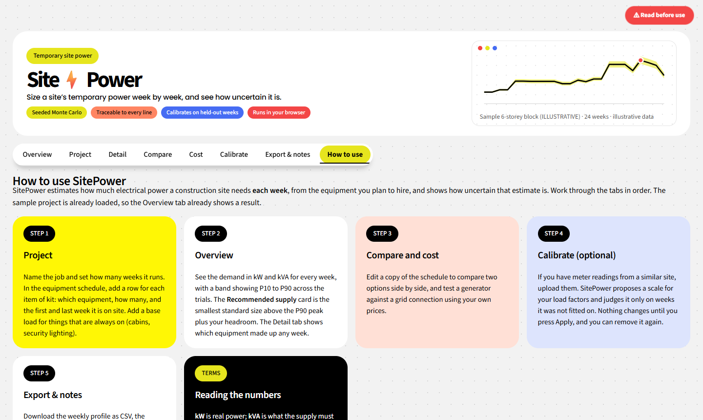<br><sub><b>How to use.</b> Step cards plus a detailed guide: every control, a worked example, data formats, glossary and FAQ.</sub></td>
  </tr>
  <tr>
    <td colspan="2" align="center">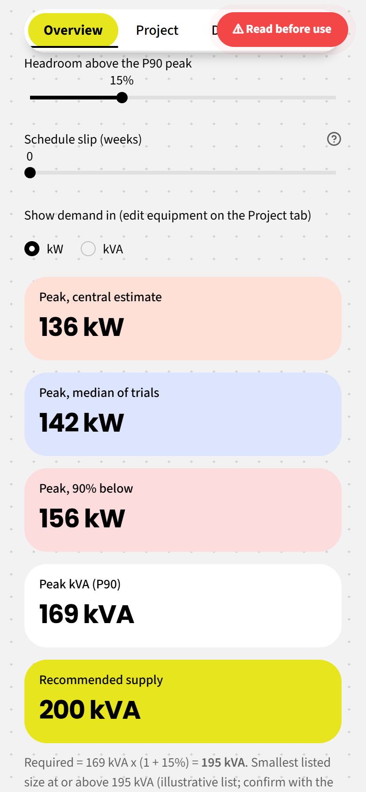<br><sub><b>Phone-width layout.</b> The hero, tags and cards reflow.</sub></td>
  </tr>
</table>

## Hosting: GitHub Pages, no server

GitHub Pages only serves static files, so the app is built with [stlite](https://github.com/whitphx/stlite) (Streamlit compiled to WebAssembly, run by Pyodide). The visitor's browser downloads the Python files in this repo and runs them locally. The same `app/streamlit_app.py` and the same `sitepower` library run natively and in the browser; nothing was rewritten.

```
python scripts/build_site.py          # writes site/ (index.html + the app, library and sample data)
python -m http.server --directory site   # preview at http://localhost:8000
```

The live page is the contents of `site/` on the `gh-pages` branch. `docs/ci/pages.yml` is an Actions workflow that does the same (parked: pushing workflow files needs a token scope I did not grant).

What I measured on one desktop machine (headless Edge, fresh profile, a local static server):

| | Result |
|---|---|
| First visit, nothing cached | about 13 to 23 s to the first result, about 41 MB downloaded (Python runtime, numpy, pandas, Streamlit's front end) |
| Repeat visit, browser cache warm | about 7 s |
| Sample-project numbers in the browser vs native | identical (136 kW central peak, 142 / 156 kW P50 / P90, 200 kVA) |
| CSV and JSON downloads in the browser | work (files written with the right content) |
| Full flow in the browser: load sample metered data, apply the calibration (136 to 163 kW), remove it | works, restores 136 kW exactly, no errors |

Trade-offs to know about: the first load is heavy; the page needs a browser with module-worker support; stlite and Python come from a pinned CDN version (jsdelivr), so it is **not** an offline app. Inside the browser the app runs on Python 3.14 with pandas 3 and numpy 2.4, while the test suite runs natively on Python 3.10, so the in-browser path is checked by the manual end-to-end run above, not by the automated suite.

## Run it natively

```
python -m venv .venv
.venv\Scripts\activate            # macOS/Linux: source .venv/bin/activate
pip install -e ".[app,dev]"
streamlit run app/streamlit_app.py
```

It also starts from a plain checkout without `pip install -e .`. Developer checks:

```
pytest --cov        # tests + coverage (fails below 90%)
ruff check . && ruff format --check .
mypy                # strict, on src/
```

## How it is calculated

For each booking in each week it is on site: `kW = qty x rated_kW x load_factor`, and `kVA = kW / power_factor`. Items in a **diversity group** are summed and multiplied by that group's factor (default 1.0). A **base load** is added every week. kVA is the arithmetic sum of per-item kVA, a stated conservative simplification.

| Quantity | How | Does not cover |
|---|---|---|
| Central estimate | every item at its modal load factor | schedule slips, missing equipment |
| P10 / P50 / P90 | seeded Monte Carlo over load factors (triangular) | wrong rated power, wrong diversity factors |
| Recommended supply | P90 peak kVA x (1 + headroom) -> smallest listed size | the supplier's real options and prices |
| Calibration scale | least squares on the first 70% of metered weeks | anything the held-out weeks do not show |

All randomness goes through an explicit seed: the same project, library and seed always give identical output (tested).

## How it is validated

- **Golden tests worked by hand**: single item, quantities, group diversity, base load, overlapping bookings. Each derivation is in [docs/VALIDATION.md](docs/VALIDATION.md).
- **Independent hand calculation of the sample project's peak week** (week 21 = 136.37 kW), done from the data files without calling the library.
- **Monte Carlo checks**: a zero-width distribution reproduces the deterministic result exactly; the sample mean matches the triangular mean within 1%; same seed identical, different seed different; P10 <= P50 <= P90.
- **Property tests**: demand never falls as quantity rises; sizing is monotone in the peak; no NaN or negative values for valid input.
- **Calibration**: known scales are recovered from noise-free data; metrics use held-out weeks only (a test recomputes them by hand); too little data is refused with a reason.
- **The real app is tested end to end** with Streamlit's `AppTest`, including applying and removing a calibration.

## Limitations (read this)

- **The equipment library is illustrative.** Every figure is a labelled placeholder, not from a datasheet. Replace it with your own: upload a CSV in the sidebar, or add `data/equipment.local.csv` (git-ignored).
- **The sizing list is illustrative.** Replace it with the supplier's real options.
- **The band reflects load-factor uncertainty only by default.** Schedule slip is covered only when you set it; missing equipment, wrong diversity factors and wrong rated powers never are. The slip model is simple (uniform whole-week delay per hire).
- **The cost model is deliberately simple** (connection, energy and weekly hire only) and every price is a placeholder you must replace.
- **The metered example is synthetic.** It was generated by this project from the same model, **assuming the illustrative library under-estimates by about 25%**. Calibration working on it shows the mechanics and nothing more. It says nothing about accuracy on a real site; that would need real metered data from several projects.
- **Calibration fits one global scale by default.** I first fitted one scale per category and measured it on the synthetic example: with 11 fitting weeks and 7 categories, scales could not be separated reliably (errors of 3% to 35% depending on shrinkage) and held-out error sometimes got worse. Per-category fitting remains as an advanced option that warns when there are too few weeks. See the "What the evidence changed" section of [docs/VALIDATION.md](docs/VALIDATION.md).
- Not a network study, cable or protection design, harmonic study, or DNO application. No accounts, database or LLM.
- **Load measurements are from a local static server**, not the live GitHub Pages URL, so real-world load times will differ with network speed.
- **Browser versions.** I tested one browser (Edge). Firefox and Safari are untested.

## Loading your own data

Equipment CSV, one row per item:

```
id,name,category,rated_kw,power_factor,load_factor_min,load_factor_mode,load_factor_max,diversity_group,source
crane1,Tower crane,lifting,45,0.85,0.25,0.40,0.65,cranes,hire sheet 2025-03
```

`0 < load_factor_min <= load_factor_mode <= load_factor_max <= 1`. Bad rows are reported with their row number and the rest still load. Metered data: `timestamp,kw` (ISO timestamps, any interval; lines starting `#` are comments).

## Repository layout

```
src/sitepower/   pure library: models, library, io, estimate, montecarlo, sizing, calibrate, synth, uimodel
app/             thin Streamlit page, no calculations
data/            illustrative equipment, sample project, SYNTHETIC metered data
tests/           golden, property, round-trip and end-to-end app tests
docs/            VALIDATION.md, DECISIONS.md, ARCHITECTURE.md, ci/ (workflow files), screenshots/
```

## Roadmap

Schedule uncertainty (hire dates slipping), real metered-data connectors, scenario comparison (crane vs mobile crane), generator versus grid cost comparison, supplier size catalogues, per-phase reporting.
